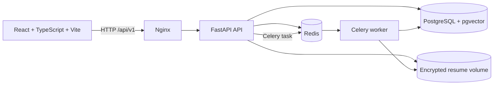
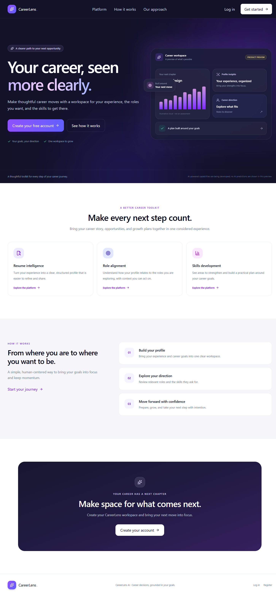

<<<<<<< HEAD
# CareerLens AI

CareerLens AI is a recruitment and career recommendation platform. This
repository includes a React/TypeScript frontend and a FastAPI backend with
PostgreSQL persistence, role-aware JWT authentication, evidence-based resume
document extraction, and semantic job matching.

## Project structure

- `backend/app/api/v1`: versioned HTTP routes
- `backend/app/core`: configuration, database session, password/JWT security, logging
- `backend/app/models`: SQLAlchemy 2.0 models
- `backend/app/repositories`: persistence package for future query abstractions
- `backend/app/schemas`: Pydantic request/response schemas
- `backend/app/services`: authentication, candidate, job, resume extraction, private storage, matching, and evaluation workflows
- `backend/app/ml`: spaCy-backed skill extraction, configurable skill taxonomy, and Sentence Transformer matching
- `backend/alembic`: database migration environment and revisions
- `backend/tests`: API, authorization, matching, and evaluation tests
- `backend/frontend/src`: React pages, components, API client, and API-backed flows

## Prerequisites

- Python 3.12 (the Docker image and CI test against 3.12)
- Node.js 22 LTS (Vite 8 requires a current Node.js release)
- npm
- Docker Desktop (for PostgreSQL with pgvector and Redis)

## Environment setup

Copy `.env.example` to `.env` only if you do not already have a local `.env`.
Do not overwrite existing credentials. Generate and set a unique `SECRET_KEY`
of at least 32 characters, a distinct `RESUME_ENCRYPTION_KEY` of at least 32
characters, and a strong database password. In PowerShell, generate each key
with `python -c "import secrets; print(secrets.token_urlsafe(48))"` and paste
the results directly into the local `.env`. Set the same
`DB_PASSWORD` in `.env`; when `DATABASE_URL` is empty, the backend builds the
PostgreSQL URL from the individual `DB_*` values and safely encodes credentials.
`SECRET_KEY` values containing the example placeholder are rejected at startup.

```powershell
Copy-Item .env.example .env
```

Keep `.env` private; it is ignored by Git. The backend and Alembic load the
repository-root `.env`. The settings module validates required credentials
before the application starts.

## Run the complete stack with Docker Compose

From the repository root:

```powershell
# Edit .env: set generated DB_PASSWORD, SECRET_KEY, RESUME_ENCRYPTION_KEY,
# and CORS_ALLOWED_ORIGINS=["http://localhost:8080"].
docker compose up --build
```

Compose starts PostgreSQL with pgvector, Redis, a one-shot Alembic migration,
the FastAPI API, a Celery resume-processing worker, and the React/Nginx frontend.
The app is published only on `127.0.0.1:8080`; put a TLS-terminating reverse
proxy in front of it for deployment. PostgreSQL is loopback-only and Redis is
private to the Compose network. Encrypted resume files use a named volume shared
between API and worker. The separate `RESUME_ENCRYPTION_KEY` must be backed up
securely and kept unchanged when restoring the resume volume.

Open `http://localhost:8080`, API docs at `http://localhost:8080/docs`, and
readiness at `http://localhost:8080/ready`. Resume uploads return immediately
with a processing state; the frontend polls the owner-only resume task endpoint
until extraction completes. The Gemini key is optional for other workflows and
must remain server-side.

Compose environment variables are read from `.env`; never commit it. The
`CORS_ALLOWED_ORIGINS` value must be a JSON string array of exact browser
origins, e.g. `["https://careerlens.example.com"]` in the `.env` file.

To run only data services for local development:

```powershell
docker compose up -d db redis
```

## Install and migrate the backend

```powershell
py -3.12 -m venv backend\.venv
backend\.venv\Scripts\Activate.ps1
python -m pip install --index-url https://download.pytorch.org/whl/cpu torch
python -m pip install -r backend\requirements.txt
alembic -c alembic.ini upgrade head
```

Run the API from the repository root:

```powershell
python -m uvicorn app.main:app --app-dir backend --reload
```

The API is available at `http://localhost:8000`; OpenAPI documentation is at
`http://localhost:8000/docs`. The health endpoints are `/health` and
`/api/v1/health`.

### Resume intelligence

The backend requirements include PDF/DOCX parsing, spaCy skill matching,
multipart uploads, and encrypted local file storage. No spaCy model is
downloaded automatically. If `SPACY_MODEL` is unavailable, the service logs a
warning and uses spaCy's blank English tokenizer/sentence segmenter; it does not
perform named-entity inference. If spaCy's native components cannot load, the
service logs a warning, performs exact case-insensitive taxonomy matching
without NLP segmentation, and reports that limitation in the analysis response.

Uploads are limited by `RESUME_MAX_FILE_SIZE_BYTES` (10 MiB by default),
`RESUME_MAX_PAGES` (100 PDF pages by default), and
`RESUME_MAX_EXTRACTED_CHARS` (1 million characters by default). PDF and DOCX
signatures/container structure are checked before parsing. Files are encrypted
with AES-GCM and written under `RESUME_STORAGE_DIR`, which must be private and
outside any web-served directory. The encryption key is derived from
`SECRET_KEY` by default; for production, configure a distinct high-entropy
`RESUME_ENCRYPTION_KEY` and keep a protected backup because losing it makes
stored files unreadable. Never rotate either key without a planned
re-encryption process.

The JSON taxonomy at `SKILL_TAXONOMY_PATH` maps canonical skills to recognized
aliases. Education, experience, projects, and certifications are returned only
as source-labelled text snippets under recognized section headings. Contacts
are encrypted at rest in PostgreSQL and excluded from API analysis responses;
email, phone, and web-link patterns are redacted from evidence snippets.
Formatting heuristics may miss or misclassify resume sections; results are not
verified qualifications or
predictions. Image-only/scanned documents are stored with a `scanned` status,
but OCR is not configured and no facts are inferred from images. DOCX page
counts are not reliably available and are not represented as a number.

### Semantic job matching

The matching engine encodes only taxonomy-normalized candidate skills,
taxonomy skills found in work-experience evidence, the job title, and
taxonomy skills found in the job description. It does not embed raw resumes,
contact details, names, photographs, or arbitrary free-form descriptions.
Explicit job criteria are supplied when a recruiter creates a job:
`required_skills`, `minimum_experience_years`, and `required_education`.
Skills mentioned in the description are not silently treated as required.
Education is compared only when the job explicitly states an education
requirement; experience duration is estimated only from dates in extracted
experience evidence.

The default scoring policy is a configurable weighted mean:

- Skill compatibility: 0.35 × matching explicitly required skills / required skills.
- Relevant experience: 0.30 × the conservative minimum of relevant skills in
  work evidence and, when specified, experience-years coverage.
- Description semantic similarity: 0.25 × clipped cosine similarity from
  Sentence Transformer vectors, calculated with scikit-learn.
- Education relevance: 0.10 × exact explicit requirement evidence, only when
  `required_education` is set.

The configured weights are validated to be within `[0, 1]` and sum to `1`.
Criteria not stated by a job are excluded and the remaining applicable weights
are renormalized; missing candidate evidence for an explicitly stated
requirement scores zero. Each response includes component scores, configured
and effective weights, matches, missing required skills, and evidence-based
explanations. The resulting 0–100 compatibility score is **not** a probability
of being hired or a validated prediction.

The initial weights are a transparent policy baseline, not a claim of
empirically optimal weights. Before production use, evaluate and calibrate them
with representative, independently labeled relevance data. A small synthetic
curated dataset is included for repeatable offline evaluation; its metrics do
not establish real-world ranking quality or fairness. Run the evaluation with:

```powershell
$env:PYTHONPATH = "backend"
python backend\scripts\evaluate_matching.py
```

The first run may download the configured
`MATCHING_EMBEDDING_MODEL`; pre-cache the model for offline or production
deployments. The embedding dimension is fixed at 384 by the database schema.
To change it, update the schema and create a migration. Configure policy weights
through `MATCHING_SKILL_WEIGHT`, `MATCHING_EXPERIENCE_WEIGHT`,
`MATCHING_SEMANTIC_WEIGHT`, and `MATCHING_EDUCATION_WEIGHT`.

Protected attributes such as age, gender, religion, caste, and photographs are
not model or scoring inputs. This exclusion reduces direct use of those
attributes but is not a fairness certification; skill taxonomies, job
requirements, and labeled relevance data still require review for proxy bias.

### Skill gaps and career development

The skill-gap API compares the latest completed resume with a selected active
job's `required_skills`. It canonicalizes names through the configurable
`skill_taxonomy.json` and separates evidence into:

- **Strong match:** the skill was found in a recognized Skills section.
- **Partial match:** the skill was found in work-experience evidence or elsewhere
  in resume text, but not in a recognized Skills section.
- **Missing:** no taxonomy match was found in extracted resume text.

The extraction is heuristic: these categories do not establish proficiency,
verify qualifications, or predict job performance. Resume facts remain
source-labelled, and learning progress is only the candidate's self-reported
status for a curated resource. An in-progress resource is shown as 50% and a
completed resource as 100%; this is activity tracking, not a measure of skill
mastery.

`backend/app/ml/learning_resources.json` contains manually curated links to
official documentation, nonprofit foundations, and recognized learning
providers. Each resource identifies its provider and purpose. The catalog is
not generated by an LLM; a skill without a catalog entry has no resource
recommendation. Related roles are drawn only from active recruiter-created job
listings and ranked by explicit taxonomy skill overlap. They are not generated
openings or hiring predictions.

Candidate-owned learning status is stored in `learning_activities`; apply the
new migration before using these endpoints:

- `GET /api/v1/skill-gaps/analysis?job_id={job_id}` — candidate role; latest
  analyzed resume vs. an active job's required skills
- `GET /api/v1/skill-gaps/related-jobs?limit=10` — candidate role; active
  listings with skill overlap
- `GET /api/v1/skill-gaps/activities` — candidate-owned learning activities
- `POST /api/v1/skill-gaps/activities` — create or update a tracked activity
  for a resource in the curated catalog
- `PATCH /api/v1/skill-gaps/activities/{activity_id}` — change status to
  `PLANNED`, `IN_PROGRESS`, or `COMPLETED`

Activity creation accepts a canonical `skill`, a catalog `resource_id`, and an
optional status:

```json
{
  "skill": "React",
  "resource_id": "react-learn",
  "status": "IN_PROGRESS"
}
```

The React skill roadmap uses these API responses and requires a candidate
account plus an analyzed resume. Sign-in tokens are held in browser
`sessionStorage` for the current tab and sent as Bearer tokens. For production
deployments exposed to untrusted scripts, prefer a backend-for-frontend with
Secure, HttpOnly, SameSite cookies instead of browser-accessible token storage.

### AI interview preparation

Interview practice is available to authenticated candidates with an analyzed
resume and an active recruiter-created job. The question generator receives the
target job title and required skills plus skill names extracted from the resume;
it does not receive raw resume files, resume text, or contact details. When a
candidate submits an answer for feedback, that answer, its question, and the
target role/skills are sent to the Gemini API. Configure the key only on the
backend server using `GEMINI_API_KEY` (never `VITE_*`); `GEMINI_MODEL` defaults
to `gemini-2.5-flash`. Without a configured key, generation and evaluation
return HTTP 503 rather than fabricated results.

Apply the interview preparation migration before using the endpoints:

- `GET /api/v1/interviews/roles` — active roles with explicit required skills
- `POST /api/v1/interviews/sessions` — generate a saved, mixed technical/HR
  question set for a selected `job_id` (`technical_questions` and
  `hr_questions`, each 1–10)
- `GET /api/v1/interviews/sessions` and
  `GET /api/v1/interviews/sessions/{session_id}` — candidate-owned history and
  question/answer/feedback details
- `POST /api/v1/interviews/sessions/{session_id}/questions/{question_id}/answer`
  — save an answer and request criterion-based feedback
- `GET /api/v1/interviews/analytics` — candidate's session progress and average
  rubric results

Gemini feedback uses four 1–5 criteria: relevance, technical correctness,
clarity, and completeness. Individual criterion explanations, overall feedback,
strengths, and improvement suggestions are persisted with each answer. The
model's judgment can be incorrect or biased; scores are subjective practice
signals and are **not an objective measure of employability, job performance,
or hiring outcomes**. The module does not claim to verify the answer or the
resume's skill claims. Keep the key server-side and review Google's current API
data handling and retention terms before processing candidate responses.

### Migration workflow

After changing SQLAlchemy models, create a revision and review the generated
operations before applying it:

```powershell
alembic -c alembic.ini revision --autogenerate -m "describe schema change"
alembic -c alembic.ini upgrade head
```

Other useful commands:

```powershell
alembic -c alembic.ini current
alembic -c alembic.ini history
alembic -c alembic.ini downgrade -1
```

Do not edit an already-applied migration to make schema changes; create a new
revision. `alembic.ini` contains no database credentials; migrations use the
same validated `DATABASE_URL` as the application.

## Authentication and API testing

Registration and login accept JSON. New accounts require a role of `CANDIDATE`
or `RECRUITER`, a name, and a password of at least 12 characters. Recruiter
registration also requires a company name. Login returns a bearer access token.
Send it as `Authorization: Bearer <access_token>` to protected endpoints.

Example registration from PowerShell:

```powershell
$candidate = Invoke-RestMethod `
  -Uri http://localhost:8000/api/v1/auth/register `
  -Method Post `
  -ContentType application/json `
  -Body '{"email":"candidate@example.com","password":"example-only-password","role":"CANDIDATE","full_name":"Jordan Davis"}'
$token = $candidate.access_token
Invoke-RestMethod `
  -Uri http://localhost:8000/api/v1/auth/me `
  -Headers @{ Authorization = "Bearer $token" }
```

API endpoints:

- `POST /api/v1/auth/register`
- `POST /api/v1/auth/login`
- `GET /api/v1/auth/me` — authenticated
- `GET /api/v1/candidates/profile` — candidate role
- `PUT /api/v1/candidates/profile` — candidate role
- `GET /api/v1/candidates/dashboard` — candidate role; real account data only
- `GET /api/v1/jobs` — public, filterable and paginated
- `GET /api/v1/jobs/{job_id}` — public
- `POST /api/v1/jobs` — recruiter role
- `GET /api/v1/jobs/mine` — recruiter role; only the authenticated recruiter's jobs
- `POST /api/v1/resumes/upload` — candidate role; multipart form field `file`
- `GET /api/v1/resumes` — candidate-owned resume metadata
- `GET /api/v1/resumes/{resume_id}` — owning candidate only
- `GET /api/v1/resumes/{resume_id}/task` — owning candidate; background processing status
- `GET /api/v1/resumes/{resume_id}/analysis` — owning candidate only; source-labelled extracted facts, with contacts redacted
- `POST /api/v1/matching/analyze` — candidate role; JSON body includes `job_id` and optional owned `resume_id`
- `GET /api/v1/matching/recommendations?limit=20` — candidate role; ranks active jobs for the latest analyzed resume (or optional `resume_id`)
- `GET /api/v1/matching/{match_id}` — candidate who owns the match only
- Skill-gap and learning-activity endpoints listed above — candidate role;
  activity records are scoped to their owner

Jobs can carry structured matching criteria in their recruiter-created JSON
body:

```json
{
  "title": "Python Backend Engineer",
  "description": "Build APIs and data services.",
  "required_skills": ["Python", "FastAPI", "PostgreSQL"],
  "minimum_experience_years": 3,
  "required_education": "Bachelor of Science"
}
```

Example resume upload from PowerShell:

```powershell
$token = "<candidate access token>"
$resume = Invoke-RestMethod `
  -Uri http://localhost:8000/api/v1/resumes/upload `
  -Method Post `
  -Headers @{ Authorization = "Bearer $token" } `
  -Form @{ file = Get-Item .\resume.pdf }
Invoke-RestMethod `
  -Uri "http://localhost:8000/api/v1/resumes/$($resume.id)/analysis" `
  -Headers @{ Authorization = "Bearer $token" }
```

Interactive API testing is also available through `/docs`. Passwords are
Argon2-hashed; tokens are signed using the required environment secret.
Authentication responses never include password hashes. Resume storage fields
and original document contents are not exposed by API response schemas.

## Run backend tests

The test suite uses an isolated in-memory SQLite database and a test-only
signing secret; it does not connect to your PostgreSQL database.

```powershell
python -m pip install --index-url https://download.pytorch.org/whl/cpu torch
python -m pip install -r backend\requirements-dev.txt
python -m pytest backend\tests -q
```

Tests cover password-safe registration responses, login, current-user access,
candidate/recruiter route authorization, profile updates, job access, duplicate
registration, validation responses, resume parsing, encryption, response
redaction, file limits, ownership checks, matching explanations, explicit
requirements, ranking metrics, evidence-based skill-gap categorization,
curated learning-resource validation, activity ownership/progress, and related
active-job recommendations, Gemini question/evaluation response validation,
interview answer persistence, candidate ownership, performance analytics,
dashboard data provenance, recruiter-owned job listings, and resume task status.

## Run the frontend

In another terminal:

```powershell
Set-Location backend\frontend
npm install
npm run dev
```

The Vite development server runs at `http://localhost:5173`. Set
`VITE_API_BASE_URL` in the root `.env` to override the default API base URL.
Candidate dashboard, profile, resume analysis, job matching, and recruiter
listing flows use the API. No illustrative match percentages or resume scores
are shown in production pages.

## Frontend checks

```powershell
Set-Location backend\frontend
npm run build
npm run lint
npm test
```

## Architecture



### Landing page



## Deployment notes and limitations

- Set `APP_ENV=production` through Compose, use unique generated secrets, and
  configure exact HTTPS CORS origins. Do not expose PostgreSQL or Redis directly
  to the public internet.
- The Compose health check verifies both database and Redis reachability.
  `docker compose logs api worker` provides service logs; uploaded documents and
  request bodies are not logged.
- Back up PostgreSQL and the encrypted resume volume together. Losing the resume
  encryption key makes stored documents unreadable. Protect backups with
  encryption and restricted access.
- The recruiter UI currently creates and lists only its own job posts. It does
  not claim to rank applicants because a candidate application workflow and
  applicant records are not yet exposed.
- Model weights may be downloaded the first time matching is used. Provision
  network access or pre-cache the configured model in restricted deployments.
- OCR is not configured; scanned resumes are reported without inferred facts.
- No screenshot fixture with synthetic user data is committed. Use a test
  account and non-real resume data when capturing deployment screenshots.

## Continuous integration

GitHub Actions runs backend tests and migration checks against pgvector, plus
frontend lint, unit tests, and production build. Locally, run:

```powershell
python -m pytest backend\tests -q
Set-Location backend\frontend
npm ci
npm test
npm run lint
npm run build
```

## Security notes

- Never commit `.env` or use real credentials in `.env.example`.
- CORS allows only origins in `CORS_ALLOWED_ORIGINS` (or `FRONTEND_URL` when no
  list is configured); wildcard origins are rejected.
- Unexpected errors return a generic message and request ID; logs omit request
  bodies, credentials, tokens, and resume contents.
- Authorization checks the active user and role from PostgreSQL for each
  protected request.
- Resume extraction returns evidence from uploaded document text only. Matching
does not verify resume claims, predict hiring outcomes, or certify fairness.
=======
# CareerLens AI

CareerLens AI is a recruitment and career recommendation platform. This
repository includes a React/TypeScript frontend and a FastAPI backend with
PostgreSQL persistence, role-aware JWT authentication, evidence-based resume
document extraction, and semantic job matching.

## Project structure

- `backend/app/api/v1`: versioned HTTP routes
- `backend/app/core`: configuration, database session, password/JWT security, logging
- `backend/app/models`: SQLAlchemy 2.0 models
- `backend/app/repositories`: persistence package for future query abstractions
- `backend/app/schemas`: Pydantic request/response schemas
- `backend/app/services`: authentication, candidate, job, resume extraction, private storage, matching, and evaluation workflows
- `backend/app/ml`: spaCy-backed skill extraction, configurable skill taxonomy, and Sentence Transformer matching
- `backend/alembic`: database migration environment and revisions
- `backend/tests`: API, authorization, matching, and evaluation tests
- `backend/frontend/src`: React pages, components, API client, and API-backed flows

## Prerequisites

- Python 3.12 (the Docker image and CI test against 3.12)
- Node.js 22 LTS (Vite 8 requires a current Node.js release)
- npm
- Docker Desktop (for PostgreSQL with pgvector and Redis)

## Environment setup

Copy `.env.example` to `.env` only if you do not already have a local `.env`.
Do not overwrite existing credentials. Generate and set a unique `SECRET_KEY`
of at least 32 characters, a distinct `RESUME_ENCRYPTION_KEY` of at least 32
characters, and a strong database password. In PowerShell, generate each key
with `python -c "import secrets; print(secrets.token_urlsafe(48))"` and paste
the results directly into the local `.env`. Set the same
`DB_PASSWORD` in `.env`; when `DATABASE_URL` is empty, the backend builds the
PostgreSQL URL from the individual `DB_*` values and safely encodes credentials.
`SECRET_KEY` values containing the example placeholder are rejected at startup.

```powershell
Copy-Item .env.example .env
```

Keep `.env` private; it is ignored by Git. The backend and Alembic load the
repository-root `.env`. The settings module validates required credentials
before the application starts.

## Run the complete stack with Docker Compose

From the repository root:

```powershell
# Edit .env: set generated DB_PASSWORD, SECRET_KEY, RESUME_ENCRYPTION_KEY,
# and CORS_ALLOWED_ORIGINS=["http://localhost:8080"].
docker compose up --build
```

Compose starts PostgreSQL with pgvector, Redis, a one-shot Alembic migration,
the FastAPI API, a Celery resume-processing worker, and the React/Nginx frontend.
The app is published only on `127.0.0.1:8080`; put a TLS-terminating reverse
proxy in front of it for deployment. PostgreSQL is loopback-only and Redis is
private to the Compose network. Encrypted resume files use a named volume shared
between API and worker. The separate `RESUME_ENCRYPTION_KEY` must be backed up
securely and kept unchanged when restoring the resume volume.

Open `http://localhost:8080`, API docs at `http://localhost:8080/docs`, and
readiness at `http://localhost:8080/ready`. Resume uploads return immediately
with a processing state; the frontend polls the owner-only resume task endpoint
until extraction completes. The Gemini key is optional for other workflows and
must remain server-side.

Compose environment variables are read from `.env`; never commit it. The
`CORS_ALLOWED_ORIGINS` value must be a JSON string array of exact browser
origins, e.g. `["https://careerlens.example.com"]` in the `.env` file.

To run only data services for local development:

```powershell
docker compose up -d db redis
```

## Install and migrate the backend

```powershell
py -3.12 -m venv backend\.venv
backend\.venv\Scripts\Activate.ps1
python -m pip install --index-url https://download.pytorch.org/whl/cpu torch
python -m pip install -r backend\requirements.txt
alembic -c alembic.ini upgrade head
```

Run the API from the repository root:

```powershell
python -m uvicorn app.main:app --app-dir backend --reload
```

The API is available at `http://localhost:8000`; OpenAPI documentation is at
`http://localhost:8000/docs`. The health endpoints are `/health` and
`/api/v1/health`.

### Resume intelligence

The backend requirements include PDF/DOCX parsing, spaCy skill matching,
multipart uploads, and encrypted local file storage. No spaCy model is
downloaded automatically. If `SPACY_MODEL` is unavailable, the service logs a
warning and uses spaCy's blank English tokenizer/sentence segmenter; it does not
perform named-entity inference. If spaCy's native components cannot load, the
service logs a warning, performs exact case-insensitive taxonomy matching
without NLP segmentation, and reports that limitation in the analysis response.

Uploads are limited by `RESUME_MAX_FILE_SIZE_BYTES` (10 MiB by default),
`RESUME_MAX_PAGES` (100 PDF pages by default), and
`RESUME_MAX_EXTRACTED_CHARS` (1 million characters by default). PDF and DOCX
signatures/container structure are checked before parsing. Files are encrypted
with AES-GCM and written under `RESUME_STORAGE_DIR`, which must be private and
outside any web-served directory. The encryption key is derived from
`SECRET_KEY` by default; for production, configure a distinct high-entropy
`RESUME_ENCRYPTION_KEY` and keep a protected backup because losing it makes
stored files unreadable. Never rotate either key without a planned
re-encryption process.

The JSON taxonomy at `SKILL_TAXONOMY_PATH` maps canonical skills to recognized
aliases. Education, experience, projects, and certifications are returned only
as source-labelled text snippets under recognized section headings. Contacts
are encrypted at rest in PostgreSQL and excluded from API analysis responses;
email, phone, and web-link patterns are redacted from evidence snippets.
Formatting heuristics may miss or misclassify resume sections; results are not
verified qualifications or
predictions. Image-only/scanned documents are stored with a `scanned` status,
but OCR is not configured and no facts are inferred from images. DOCX page
counts are not reliably available and are not represented as a number.

### Semantic job matching

The matching engine encodes only taxonomy-normalized candidate skills,
taxonomy skills found in work-experience evidence, the job title, and
taxonomy skills found in the job description. It does not embed raw resumes,
contact details, names, photographs, or arbitrary free-form descriptions.
Explicit job criteria are supplied when a recruiter creates a job:
`required_skills`, `minimum_experience_years`, and `required_education`.
Skills mentioned in the description are not silently treated as required.
Education is compared only when the job explicitly states an education
requirement; experience duration is estimated only from dates in extracted
experience evidence.

The default scoring policy is a configurable weighted mean:

- Skill compatibility: 0.35 × matching explicitly required skills / required skills.
- Relevant experience: 0.30 × the conservative minimum of relevant skills in
  work evidence and, when specified, experience-years coverage.
- Description semantic similarity: 0.25 × clipped cosine similarity from
  Sentence Transformer vectors, calculated with scikit-learn.
- Education relevance: 0.10 × exact explicit requirement evidence, only when
  `required_education` is set.

The configured weights are validated to be within `[0, 1]` and sum to `1`.
Criteria not stated by a job are excluded and the remaining applicable weights
are renormalized; missing candidate evidence for an explicitly stated
requirement scores zero. Each response includes component scores, configured
and effective weights, matches, missing required skills, and evidence-based
explanations. The resulting 0–100 compatibility score is **not** a probability
of being hired or a validated prediction.

The initial weights are a transparent policy baseline, not a claim of
empirically optimal weights. Before production use, evaluate and calibrate them
with representative, independently labeled relevance data. A small synthetic
curated dataset is included for repeatable offline evaluation; its metrics do
not establish real-world ranking quality or fairness. Run the evaluation with:

```powershell
$env:PYTHONPATH = "backend"
python backend\scripts\evaluate_matching.py
```

The first run may download the configured
`MATCHING_EMBEDDING_MODEL`; pre-cache the model for offline or production
deployments. The embedding dimension is fixed at 384 by the database schema.
To change it, update the schema and create a migration. Configure policy weights
through `MATCHING_SKILL_WEIGHT`, `MATCHING_EXPERIENCE_WEIGHT`,
`MATCHING_SEMANTIC_WEIGHT`, and `MATCHING_EDUCATION_WEIGHT`.

Protected attributes such as age, gender, religion, caste, and photographs are
not model or scoring inputs. This exclusion reduces direct use of those
attributes but is not a fairness certification; skill taxonomies, job
requirements, and labeled relevance data still require review for proxy bias.

### Skill gaps and career development

The skill-gap API compares the latest completed resume with a selected active
job's `required_skills`. It canonicalizes names through the configurable
`skill_taxonomy.json` and separates evidence into:

- **Strong match:** the skill was found in a recognized Skills section.
- **Partial match:** the skill was found in work-experience evidence or elsewhere
  in resume text, but not in a recognized Skills section.
- **Missing:** no taxonomy match was found in extracted resume text.

The extraction is heuristic: these categories do not establish proficiency,
verify qualifications, or predict job performance. Resume facts remain
source-labelled, and learning progress is only the candidate's self-reported
status for a curated resource. An in-progress resource is shown as 50% and a
completed resource as 100%; this is activity tracking, not a measure of skill
mastery.

`backend/app/ml/learning_resources.json` contains manually curated links to
official documentation, nonprofit foundations, and recognized learning
providers. Each resource identifies its provider and purpose. The catalog is
not generated by an LLM; a skill without a catalog entry has no resource
recommendation. Related roles are drawn only from active recruiter-created job
listings and ranked by explicit taxonomy skill overlap. They are not generated
openings or hiring predictions.

Candidate-owned learning status is stored in `learning_activities`; apply the
new migration before using these endpoints:

- `GET /api/v1/skill-gaps/analysis?job_id={job_id}` — candidate role; latest
  analyzed resume vs. an active job's required skills
- `GET /api/v1/skill-gaps/related-jobs?limit=10` — candidate role; active
  listings with skill overlap
- `GET /api/v1/skill-gaps/activities` — candidate-owned learning activities
- `POST /api/v1/skill-gaps/activities` — create or update a tracked activity
  for a resource in the curated catalog
- `PATCH /api/v1/skill-gaps/activities/{activity_id}` — change status to
  `PLANNED`, `IN_PROGRESS`, or `COMPLETED`

Activity creation accepts a canonical `skill`, a catalog `resource_id`, and an
optional status:

```json
{
  "skill": "React",
  "resource_id": "react-learn",
  "status": "IN_PROGRESS"
}
```

The React skill roadmap uses these API responses and requires a candidate
account plus an analyzed resume. Sign-in tokens are held in browser
`sessionStorage` for the current tab and sent as Bearer tokens. For production
deployments exposed to untrusted scripts, prefer a backend-for-frontend with
Secure, HttpOnly, SameSite cookies instead of browser-accessible token storage.

### AI interview preparation

Interview practice is available to authenticated candidates with an analyzed
resume and an active recruiter-created job. The question generator receives the
target job title and required skills plus skill names extracted from the resume;
it does not receive raw resume files, resume text, or contact details. When a
candidate submits an answer for feedback, that answer, its question, and the
target role/skills are sent to the Gemini API. Configure the key only on the
backend server using `GEMINI_API_KEY` (never `VITE_*`); `GEMINI_MODEL` defaults
to `gemini-2.5-flash`. Without a configured key, generation and evaluation
return HTTP 503 rather than fabricated results.

Apply the interview preparation migration before using the endpoints:

- `GET /api/v1/interviews/roles` — active roles with explicit required skills
- `POST /api/v1/interviews/sessions` — generate a saved, mixed technical/HR
  question set for a selected `job_id` (`technical_questions` and
  `hr_questions`, each 1–10)
- `GET /api/v1/interviews/sessions` and
  `GET /api/v1/interviews/sessions/{session_id}` — candidate-owned history and
  question/answer/feedback details
- `POST /api/v1/interviews/sessions/{session_id}/questions/{question_id}/answer`
  — save an answer and request criterion-based feedback
- `GET /api/v1/interviews/analytics` — candidate's session progress and average
  rubric results

Gemini feedback uses four 1–5 criteria: relevance, technical correctness,
clarity, and completeness. Individual criterion explanations, overall feedback,
strengths, and improvement suggestions are persisted with each answer. The
model's judgment can be incorrect or biased; scores are subjective practice
signals and are **not an objective measure of employability, job performance,
or hiring outcomes**. The module does not claim to verify the answer or the
resume's skill claims. Keep the key server-side and review Google's current API
data handling and retention terms before processing candidate responses.

### Migration workflow

After changing SQLAlchemy models, create a revision and review the generated
operations before applying it:

```powershell
alembic -c alembic.ini revision --autogenerate -m "describe schema change"
alembic -c alembic.ini upgrade head
```

Other useful commands:

```powershell
alembic -c alembic.ini current
alembic -c alembic.ini history
alembic -c alembic.ini downgrade -1
```

Do not edit an already-applied migration to make schema changes; create a new
revision. `alembic.ini` contains no database credentials; migrations use the
same validated `DATABASE_URL` as the application.

## Authentication and API testing

Registration and login accept JSON. New accounts require a role of `CANDIDATE`
or `RECRUITER`, a name, and a password of at least 12 characters. Recruiter
registration also requires a company name. Login returns a bearer access token.
Send it as `Authorization: Bearer <access_token>` to protected endpoints.

Example registration from PowerShell:

```powershell
$candidate = Invoke-RestMethod `
  -Uri http://localhost:8000/api/v1/auth/register `
  -Method Post `
  -ContentType application/json `
  -Body '{"email":"candidate@example.com","password":"example-only-password","role":"CANDIDATE","full_name":"Jordan Davis"}'
$token = $candidate.access_token
Invoke-RestMethod `
  -Uri http://localhost:8000/api/v1/auth/me `
  -Headers @{ Authorization = "Bearer $token" }
```

API endpoints:

- `POST /api/v1/auth/register`
- `POST /api/v1/auth/login`
- `GET /api/v1/auth/me` — authenticated
- `GET /api/v1/candidates/profile` — candidate role
- `PUT /api/v1/candidates/profile` — candidate role
- `GET /api/v1/candidates/dashboard` — candidate role; real account data only
- `GET /api/v1/jobs` — public, filterable and paginated
- `GET /api/v1/jobs/{job_id}` — public
- `POST /api/v1/jobs` — recruiter role
- `GET /api/v1/jobs/mine` — recruiter role; only the authenticated recruiter's jobs
- `POST /api/v1/resumes/upload` — candidate role; multipart form field `file`
- `GET /api/v1/resumes` — candidate-owned resume metadata
- `GET /api/v1/resumes/{resume_id}` — owning candidate only
- `GET /api/v1/resumes/{resume_id}/task` — owning candidate; background processing status
- `GET /api/v1/resumes/{resume_id}/analysis` — owning candidate only; source-labelled extracted facts, with contacts redacted
- `POST /api/v1/matching/analyze` — candidate role; JSON body includes `job_id` and optional owned `resume_id`
- `GET /api/v1/matching/recommendations?limit=20` — candidate role; ranks active jobs for the latest analyzed resume (or optional `resume_id`)
- `GET /api/v1/matching/{match_id}` — candidate who owns the match only
- Skill-gap and learning-activity endpoints listed above — candidate role;
  activity records are scoped to their owner

Jobs can carry structured matching criteria in their recruiter-created JSON
body:

```json
{
  "title": "Python Backend Engineer",
  "description": "Build APIs and data services.",
  "required_skills": ["Python", "FastAPI", "PostgreSQL"],
  "minimum_experience_years": 3,
  "required_education": "Bachelor of Science"
}
```

Example resume upload from PowerShell:

```powershell
$token = "<candidate access token>"
$resume = Invoke-RestMethod `
  -Uri http://localhost:8000/api/v1/resumes/upload `
  -Method Post `
  -Headers @{ Authorization = "Bearer $token" } `
  -Form @{ file = Get-Item .\resume.pdf }
Invoke-RestMethod `
  -Uri "http://localhost:8000/api/v1/resumes/$($resume.id)/analysis" `
  -Headers @{ Authorization = "Bearer $token" }
```

Interactive API testing is also available through `/docs`. Passwords are
Argon2-hashed; tokens are signed using the required environment secret.
Authentication responses never include password hashes. Resume storage fields
and original document contents are not exposed by API response schemas.

## Run backend tests

The test suite uses an isolated in-memory SQLite database and a test-only
signing secret; it does not connect to your PostgreSQL database.

```powershell
python -m pip install --index-url https://download.pytorch.org/whl/cpu torch
python -m pip install -r backend\requirements-dev.txt
python -m pytest backend\tests -q
```

Tests cover password-safe registration responses, login, current-user access,
candidate/recruiter route authorization, profile updates, job access, duplicate
registration, validation responses, resume parsing, encryption, response
redaction, file limits, ownership checks, matching explanations, explicit
requirements, ranking metrics, evidence-based skill-gap categorization,
curated learning-resource validation, activity ownership/progress, and related
active-job recommendations, Gemini question/evaluation response validation,
interview answer persistence, candidate ownership, performance analytics,
dashboard data provenance, recruiter-owned job listings, and resume task status.

## Run the frontend

In another terminal:

```powershell
Set-Location backend\frontend
npm install
npm run dev
```

The Vite development server runs at `http://localhost:5173`. Set
`VITE_API_BASE_URL` in the root `.env` to override the default API base URL.
Candidate dashboard, profile, resume analysis, job matching, and recruiter
listing flows use the API. No illustrative match percentages or resume scores
are shown in production pages.

## Frontend checks

```powershell
Set-Location backend\frontend
npm run build
npm run lint
npm test
```

## Architecture


### Landing page


## Deployment notes and limitations

- Set `APP_ENV=production` through Compose, use unique generated secrets, and
  configure exact HTTPS CORS origins. Do not expose PostgreSQL or Redis directly
  to the public internet.
- The Compose health check verifies both database and Redis reachability.
  `docker compose logs api worker` provides service logs; uploaded documents and
  request bodies are not logged.
- Back up PostgreSQL and the encrypted resume volume together. Losing the resume
  encryption key makes stored documents unreadable. Protect backups with
  encryption and restricted access.
- The recruiter UI currently creates and lists only its own job posts. It does
  not claim to rank applicants because a candidate application workflow and
  applicant records are not yet exposed.
- Model weights may be downloaded the first time matching is used. Provision
  network access or pre-cache the configured model in restricted deployments.
- OCR is not configured; scanned resumes are reported without inferred facts.
- No screenshot fixture with synthetic user data is committed. Use a test
  account and non-real resume data when capturing deployment screenshots.

## Continuous integration

GitHub Actions runs backend tests and migration checks against pgvector, plus
frontend lint, unit tests, and production build. Locally, run:

```powershell
python -m pytest backend\tests -q
Set-Location backend\frontend
npm ci
npm test
npm run lint
npm run build
```

## Security notes

- Never commit `.env` or use real credentials in `.env.example`.
- CORS allows only origins in `CORS_ALLOWED_ORIGINS` (or `FRONTEND_URL` when no
  list is configured); wildcard origins are rejected.
- Unexpected errors return a generic message and request ID; logs omit request
  bodies, credentials, tokens, and resume contents.
- Authorization checks the active user and role from PostgreSQL for each
  protected request.
- Resume extraction returns evidence from uploaded document text only. Matching
does not verify resume claims, predict hiring outcomes, or certify fairness.
>>>>>>> d048a4f29b1e98b6537c2f799fc59d935c66c2c6
